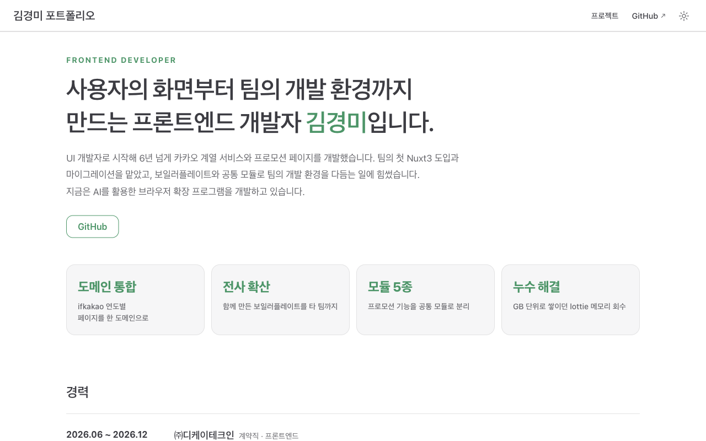

# 김경미 포트폴리오

프론트엔드 개발자 김경미의 포트폴리오 사이트 소스 저장소입니다.

**사이트 바로가기: [47kkm.github.io/portfolio](https://47kkm.github.io/portfolio/)**



## 사이트 구성

| 페이지 | 내용 |
|---|---|
| 메인 | 소개, 주요 성과, 경력, 기술 스택, 프로젝트 목록(분류 필터), 학력·자격, 연락처 |
| 프로젝트 상세 | 프로젝트 개요, 기술 스택, 주요 구현 기능, 문제 및 해결, 성과 |

## 기술 스택

- VuePress 2 (기본 테마 확장), Vue 3, SCSS
- GitHub Pages

## 구현 포인트

- **frontmatter 기반 프로젝트 목록**: 빌드할 때 각 프로젝트 문서의 frontmatter(`category`, `stack`, `description`)를 모아 목록 데이터(`@temp/projectList.js`)를 만듭니다. 문서 하나만 추가하면 메인 카드, 분류 필터, 사이드바에 함께 반영됩니다.
- **사이드바 자동 생성**: frontmatter의 `depth`, `order`로 사이드바 트리를 구성합니다.
- **기본 테마 레이아웃 확장**: 테마 `Layout`의 슬롯에 프로젝트 헤더(분류, 기술 태그)를 넣고, 문서의 개요·문제 및 해결·성과 섹션은 마크다운을 그대로 둔 채 CSS로 카드 형태로 꾸몄습니다.
- **한글 앵커 id 정규화**: 기본 slugify가 NFKD 정규화로 한글 제목 id를 자모 단위로 분리하는 문제를 NFC로 다시 조합해 해결했습니다.
- **다크 모드 대응**: 색상을 테마 CSS 변수로 지정해 라이트·다크 모드를 모두 지원합니다.

## 폴더 구조

```
docs/
├── README.md               메인 페이지
├── projects/               프로젝트 상세 문서
└── .vuepress/
    ├── config.js           사이트 설정
    ├── client.js           전역 컴포넌트, 레이아웃 등록
    ├── components/         메인 섹션, 프로젝트 카드 등 컴포넌트
    ├── layouts/            기본 테마 레이아웃 확장
    ├── data/main.js        소개, 경력, 기술 스택 등 메인 데이터
    ├── plugins/            사이드바, 프로젝트 목록 생성
    └── styles/index.scss   공통 스타일
```

## 로컬 실행

```bash
npm install
npm run docs:dev     # 개발 서버 (http://localhost:8080/portfolio/)
npm run docs:build   # 빌드 (docs/.vuepress/dist)
```

프로젝트 frontmatter를 수정했는데 목록에 반영되지 않으면 개발 서버를 다시 시작합니다.

## 프로젝트 추가

`docs/projects/`에 문서를 추가하고 frontmatter를 작성합니다.

```yaml
---
type: projects
depth: 2
title: 프로젝트 이름
description: 카드에 표시할 한 줄 설명
category: 서비스              # 서비스 | 프로모션 | 사내 도구 | 개인 프로젝트
stack: [Nuxt3, TypeScript]
period: 2024.01 ~ 2024.06     # 선택
order: 14
---
```

## 배포

```bash
sh deploy.sh
```

빌드 결과물을 `gh-pages` 브랜치에 푸시합니다.
